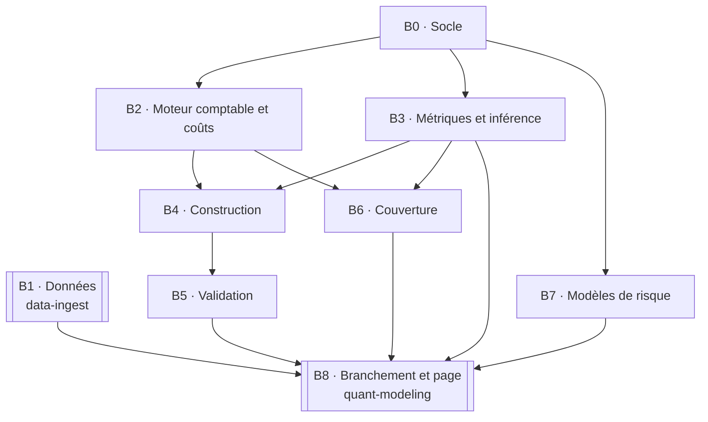

# Blueprint — quant-backtest

Spécification du chantier. Les lots et leurs critères d'acceptation sont au
[§15 du compagnon](../docs/companion.md#15-les-lots) ; ce fichier en donne la
vue d'ensemble et le graphe de dépendances. Les arbitrages, avec leurs
alternatives écartées, sont dans [`decisions.md`](decisions.md) ; la frontière
avec `quant-modeling` dans [`../docs/contract.md`](../docs/contract.md).

Quand un lot devient assez gros pour mériter sa propre spécification, elle va
dans `wp/<lot>-<nom>.md` et le tableau ci-dessous y renvoie.

> **Origine.** Ce dépôt est né du lot 24 de `quant-modeling`, qui plaçait le
> backtest dans son API, en Python. Le texte de ce lot est devenu
> [`docs/companion.md`](../docs/companion.md), canonique ici. Côté
> `quant-modeling`, le lot 24 ne décrit plus que sa moitié : le branchement du
> wheel et la page.

## 1. Pourquoi ce dépôt existe

Deux raisons, données par le mainteneur le 11 octobre 2026.

- **La performance** : la validation d'une stratégie répète le même run des
  centaines ou des milliers de fois, et le backtest de couverture enchaîne
  chemins, dates et recalibrations autour d'une lib de pricing déjà en C++.
- **Ne pas charger le dépôt de pricing** : `quant-modeling` est une lib de
  pricing de dérivés ; un moteur comptable, des statistiques de performance et
  des tests de surajustement n'en font pas partie.

La règle qui départage « même dépôt » et « dépôt séparé » est celle de
`quant-platform` : deux choses vivent dans le même dépôt si elles changent
ensemble et doivent être livrées de façon atomique ; sinon elles se parlent par
un contrat versionné. Le moteur de backtest ne change pas avec un pricer.

## 2. Les lots

| Lot | Titre | Dépôt | Résumé |
|---|---|---|---|
| B0 | Socle | ici | CMake, presets, vcpkg, GoogleTest, clang-format, CI, squelette du wheel, `quantModeling` épinglé |
| B1 | Données | `data-ingest` | Prix bruts et événements, indice dividendes réinvestis, facteurs, composition historique du S&P 500 |
| B2 | Moteur comptable et coûts | ici | Positions en titres, espèces, dividendes et divisions, chronologie déclarée, journal des ordres, coûts |
| B3 | Métriques et inférence | ici | Métriques de performance, erreurs-types, PSR, bootstrap stationnaire, régression factorielle |
| B4 | Construction et points de comparaison | ici | 1/N, variance minimale, Sharpe maximal, Ledoit-Wolf, parité de risque, test de différence de Sharpe |
| B5 | Validation | ici | Marche en avant, CPCV, Sharpe déflaté, PBO |
| B6 | Backtest de couverture | ici | Monde simulé puis surfaces historiques ; delta de Black-Scholes contre variance minimale ; explication du P&L |
| B7 | Backtest des modèles de risque | ici | Kupiec, Christoffersen, feux tricolores |
| B8 | Branchement et page | `quant-modeling` | Wheel dans l'image, lecture en base, routeur, tâche annulable, audit et replay, page `/backtest` remise en ligne |

## 3. Graphe de dépendances

À lire ainsi :

- **B0 débloque tout** ce qui est ici.
- **B2, B3 et B7 sont indépendants** entre eux : B3 et B7 ne travaillent que
  sur des séries de rendements ou de P&L.
- **B1 ne bloque aucun lot d'ici** : le moteur est testé sur des données
  construites dans les tests. B1 bloque la remise en ligne de la page sur des
  données réelles.
- **B6 est le lot qui a le plus de valeur** : c'est le seul qui exerce la lib
  de pricing. Il ne dépend que de B2 (la comptabilité) et de B3 (les
  statistiques de l'erreur de couverture).
- **B8 peut se faire par tranches** : un onglet de la page dès que le lot qui
  le nourrit est livré. La flèche de B3 est le minimum pour un premier onglet.

## 4. Définition de « fait »

Un lot est fait quand :

1. ses critères d'acceptation du §15 du compagnon passent, sous forme de tests ;
2. les constats du §2 qui lui sont attribués ont chacun leur test ;
3. `clang-format` et la CI sont verts, y compris le preset `asan` ;
4. `CLAUDE.md` (état du dépôt, commandes) et `docs/contract.md` (si l'interface
   Python a changé) sont à jour ;
5. son issue est fermée avec le commit.
